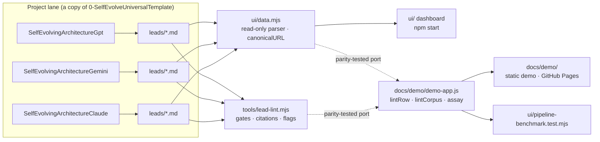
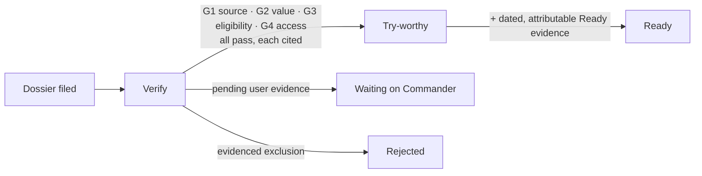
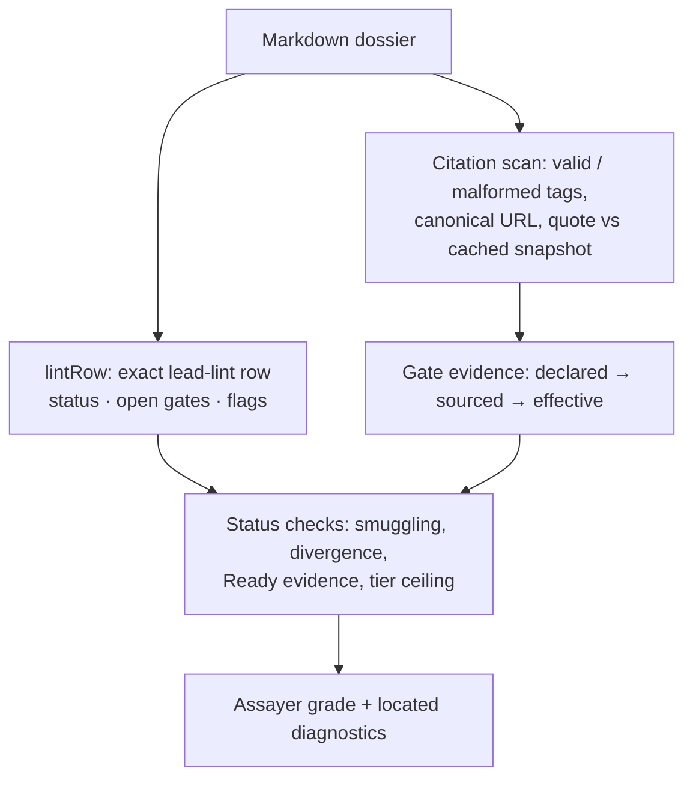

# EvolveSearcherUniversal

Autonomous self-evolving search and discovery framework with isolated verification harnesses, compute-budget subagent routing, and a shared multi-engine comparison dashboard (`Claude`, `Gemini`, `ChatGPT`).

**[▶ Static demo & linter sandbox](docs/demo/index.html)** shows the dashboard, side-by-side gate inspector and a live deterministic linter, all on 100% synthetic data with no install. When GitHub Pages serves `/docs`, the demo lives at `<pages-url>/demo/`. To run it locally, use `python3 -m http.server -d docs/demo` (browsers block `fetch()` on `file://`).

## Architecture Overview

- **[`0-SelfEvolveUniversalTemplate/`](0-SelfEvolveUniversalTemplate/README.md)**: clean universal lane template containing three independent, self-evolving discovery architectures:
  - [`SelfEvolvingArchitectureClaude`](0-SelfEvolveUniversalTemplate/SelfEvolvingArchitectureClaude/README.md): defensive, strict-verification engine designed for Claude Code (`ARCHITECT_BLUEPRINT.md`, `prompts/15_autoloop.md`).
  - [`SelfEvolvingArchitectureGemini`](0-SelfEvolveUniversalTemplate/SelfEvolvingArchitectureGemini/README.md): Gemini discovery engine.
  - [`SelfEvolvingArchitectureGpt`](0-SelfEvolveUniversalTemplate/SelfEvolvingArchitectureGpt/README.md): GPT discovery engine.
- **[`ui/`](ui/serve.mjs)**: zero-dependency Node.js (`>=20`) telemetry, prompt orchestration, and multi-lane comparison dashboard (`http://127.0.0.1:4489/`).
- **[`docs/demo/`](docs/demo/index.html)**: static, GitHub Pages-ready demo. [`demo-app.js`](docs/demo/demo-app.js) holds a parity-tested port of lead-lint plus the Assayer diagnostics; [`demo-data.json`](docs/demo/demo-data.json) holds the synthetic lanes, dossiers and source snapshots.
- **[`0-SelfEvolveUniversalTemplate/PERSONALIZE.md`](0-SelfEvolveUniversalTemplate/PERSONALIZE.md)**: lane personalization guide and verification gates.
- **[`0-SelfEvolveUniversalTemplate/PROVENANCE.md`](0-SelfEvolveUniversalTemplate/PROVENANCE.md)**: architecture provenance and retained reliability fixes.



### Grading pipeline

Tiers follow `RecallCharter.md` §7. A gate passes only when a line naming it carries `[verified: <url> "<quote>"]`.



`assay()` runs the canonical lead-lint row first and then adds what lead-lint cannot see. Every finding carries `line`, `col`, `start` and `end`, and `text.slice(start, end)` returns its excerpt exactly.



| Family | Codes | Visible to lead-lint? |
|---|---|---|
| Gates | `NO_GATES_LINE` `GATE_UNPARSED` `GATE_MISSING` `GATE_DUPLICATE` `GATE_QUALIFIED` `GATE_UNSOURCED` `GATES_DUPLICATE` | Partly: lead-lint silently reads unparsed gates as `unknown` |
| Citations | `CITATION_MISSING_QUOTE` `CITATION_EMPTY_QUOTE` `CITATION_CASE` `CITATION_NO_URL` `CITATION_UNSAFE_SCHEME` `CITATION_UNCLOSED` `CITATION_MALFORMED` `CITATION_SHARED` `CITATION_IN_CODE_FENCE` `QUOTE_BLANK` | Only as `STALE_GRADE` |
| Evidence | `QUOTE_NOT_IN_SOURCE` `URL_INVALID` `URL_NONCANONICAL` `URL_INSECURE` | No |
| Status | `STATUS_SMUGGLING` `READY_UNVALIDATED` `STATUS_DIVERGENT` `STATUS_UNREAD` `STATUS_CONFLICT` `STATUS_CASE` `STATUS_DECORATED` `STATUS_UNRECOGNIZED` `PROMOTABLE` | No |
| Flags & fields | `STALE_GRADE` `CLOSABLE` `PARKED` `DEADLINE_PAST_REVIEW` `DEADLINE_UNPARSED` `DEADLINE_INVALID` `BOM_PRESENT` `FIT_*` `URL_MISSING` `TITLE_MISSING` | First four are lead-lint flags |

## Quick Start

Requires **Node.js 20+** (zero external npm dependencies).

```bash
# Run dashboard, orchestration and pipeline benchmark suites
npm test

# Start the live comparison & telemetry dashboard at http://127.0.0.1:4489/
npm start
```

## Pipeline Benchmark

[`ui/pipeline-benchmark.test.mjs`](ui/pipeline-benchmark.test.mjs) runs 186 deterministic cases on a fixed clock (2026-11-04). The reference implementations are each engine's `tools/lead-lint.mjs` and `ui/data.mjs`, and the browser port must equal them exactly. The suite prints this scorecard after every run (`node --test ui/pipeline-benchmark.test.mjs`):

| Category | Cases | Passed | Failed | What it pins down |
|---|---:|---:|---:|---|
| Malformed gates | 31 | 31 | 0 | Comma separators, `passed`/`ok`/emoji grades, `G12` vs `G1`, duplicates, qualifiers, unreadable Gates lines, CRLF |
| Citations & quotes | 30 | 30 | 0 | Missing/empty/single quotes, tag case, unsafe schemes, unclosed tags, `G1-G4` ranges, Gates-line smuggling, fabricated quotes vs snapshots |
| URL canonicalization | 27 | 27 | 0 | `www.`, fragments, `utm_*`/`fbclid`/`gclid`, query order, ports, IDN, bad schemes, all checked against `ui/data.mjs` |
| Status smuggling | 23 | 23 | 0 | Tier above evidence, Ready without dated evidence, Notes-line smuggling, BOM-hidden status, case and decorated tiers |
| Coordinate slices | 19 | 19 | 0 | `slice(start, end) === excerpt` over every case; CRLF, BOM, astral, combining marks, tabs, 10k-char lines |
| lead-lint flags | 22 | 22 | 0 | `CLOSABLE`, `PARKED`, `DEADLINE_PAST_REVIEW` (incl. rolled-over dates), charter `STALE_GRADE`, sort order |
| Canonical parity | 8 | 8 | 0 | Whole catalog and demo corpus vs real `lintLeads` of all three engines; charter mtime; dashboard field reader |
| Demo corpus | 24 | 24 | 0 | Each synthetic dossier grades as labelled; RFC 2606 hosts only; no personal identifiers; self-contained page |
| Determinism & benchmark | 2 | 2 | 0 | Identical output across runs and source orderings; throughput |
| **Total** | **186** | **186** | **0** | |

Throughput comes from one run on Node 22 in a cloud container, so timings depend on the machine:

| Benchmark | Dossiers | Time (ms) | Dossiers/s |
|---|---:|---:|---:|
| `lintRow` (port, per dossier) | 2,000 | 19.8 | 100,919 |
| `assay` (full Assayer, per dossier) | 2,000 | 362.6 | 5,516 |
| `lintCorpus` (port, whole folder) | 2,000 | 19.9 | 100,732 |
| `lintLeads` (canonical, filesystem) | 2,000 | 74.0 | 27,023 |

## Companion Packages (packages/)

**[▶ Portfolio hub](docs/portfolio/index.html)** · [PORTFOLIO.md](PORTFOLIO.md): every package in one view, verified by `npm run test:all`.

| Package | Description | Demo / Docs |
|---|---|---|
| [packages/llm-app-hardening-kit](packages/llm-app-hardening-kit/README.md) | Cost circuit breaker (5h/7d rolling windows), streaming/batch output guard, and llm-harden static scanner CLI (12 rules, 25 broken/hardened fixture pairs) | [docs/demo-report.html](packages/llm-app-hardening-kit/docs/demo-report.html) |
| [packages/webchat-batch-packer](packages/webchat-batch-packer/README.md) | Zero-token prompt packet compiler, deterministic HTML noise stripper (90–98.5% reduction), and strict multi-file reply unpacker | [docs/index.html](packages/webchat-batch-packer/docs/index.html) |
| [packages/multi-model-routing-bench](packages/multi-model-routing-bench/README.md) | Normalized Cost-Unit (CU) routing calculator, multi-cycle studio simulator, and failure-mode evaluation harness | [docs/index.html](packages/multi-model-routing-bench/docs/index.html) |
| [packages/form-schema-autofill-engine](packages/form-schema-autofill-engine/README.md) | Pure-JS DOM form classifier, ATS adapters (Greenhouse, Lever, Ashby, Workday, Generic), and 55 HTML replay fixtures | [docs/index.html](packages/form-schema-autofill-engine/docs/index.html) |
