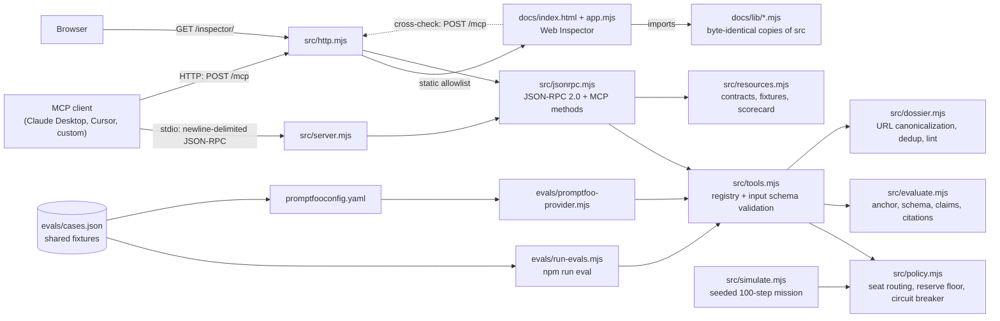

# agent-orchestration-mcp-eval

A zero-dependency Model Context Protocol (MCP) server that exposes three deterministic policy tools: seat routing with budget admission, agent-response contract checks, and dossier URL/markdown linting. The same decision code runs behind the MCP server, a browser Web Inspector, a native eval harness, and a Promptfoo provider, so the evidence a reviewer sees is the evidence the server enforces.

- **Runtime:** Node.js, ES modules, no `dependencies` in `package.json`. Declared `engines.node >=20`; verified on Node 22.14.0 only.
- **Web Inspector:** `docs/index.html`, an interactive playground for all three tools. Plain ES modules, no CDN, no build step. Served at `GET /inspector/` by the HTTP transport, or hostable as static files.
- **Protocol:** JSON-RPC 2.0 over stdio (newline-delimited) and HTTP (`POST /mcp`). Implements `initialize`, `ping`, `tools/list`, `tools/call`, `resources/list`, `resources/read`. Request IDs must be strings or integers. HTTP refuses unsupported `MCP-Protocol-Version` headers (400) and JSON-RPC batch bodies (400).
- **License:** MIT.

## Verified status

| Check | Command | Result |
| :--- | :--- | :--- |
| Unit, protocol, stdio, HTTP, simulator and inspector tests | `npm test` (runs `node --test`) | 57/57 pass (Node 22.23.4) |
| Native deterministic eval | `npm run eval` | 206/206 pass, 0 false accepts, 0 false rejects (Node 22.23.4) |
| Sanitization gate | `npm run sanitize` | 0 hits in the tree (41 files, now including `.html` and `.css`) and in every reachable commit (Node 22.23.4) |
| Web Inspector in a real browser | Playwright + Chromium against `npm run start:http` | All three tabs render, every result agrees with live `POST /mcp`, no console errors, no horizontal scroll at 390 px, light and dark |
| Benchmark | `npm run bench` | Results below |
| Promptfoo eval on the same fixtures | `npx promptfoo@0.120.19 eval -c promptfooconfig.yaml` | 206/206 pass (Node 22.23.4) |

Not yet verified: connecting a third-party MCP client (Claude Desktop, Cursor) to this server. The configuration below follows each client's documented `mcpServers` format but has not been exercised.

## Architecture



Design rules:

- **Pure core.** `policy.mjs`, `evaluate.mjs` and `dossier.mjs` do no I/O and no clock reads. Same input, same output.
- **Fail closed.** Unknown roles, modes, tiers and malformed accounting values are refused. Accounting values must be finite numbers, checked against the schema before any arithmetic. A negative `usedCU` cannot widen capacity.
- **Schema subset enforced.** Tool input schemas and response contracts use a small JSON Schema subset. Any keyword outside that subset throws at registration instead of being ignored.
- **Transport-free decisions.** The MCP server, Web Inspector, native harness and Promptfoo provider all call `callTool()`, so there is one code path to test. The inspector imports `docs/lib/`, which `npm run sync-docs` copies from `src/`. A test fails if the copies differ by a single byte.

## Tools

Full schemas: `resources/read` on `agent-eval://contracts/tools`.

### `route_agent_seat`

Routes a worker role to a cost tier, then admits its planned spend against a budget snapshot.

| Field | Type | Notes |
| :--- | :--- | :--- |
| `role` | enum | `grunt` (cheap, 0.09 CU), `scout` (mid, 0.9), `mechanic` and `sniper` (heavy, 1.8), `auditor` (judgment, 3.6). |
| `mode` | enum | `read-only` (default) or `workspace-write`. `auditor` is hard-locked to `read-only`. |
| `budget.usedCU` | number ≥ 0 | CU already spent in the window. |
| `budget.capacityCU` | number > 0 | Window capacity in CU. |
| `budget.reservePct` | number 0–100 | Share of capacity held back. agent share = capacity × (100 − reservePct) / 100. |
| `budget.judgmentUsedCU`, `budget.judgmentAllowanceCU` | number ≥ 0 | Judgment-tier spend needs an allowance. Default 0 refuses judgment seats. |
| `budget.consecutiveFailures`, `budget.failureThreshold` | integer | The circuit breaker opens at `failureThreshold` (default 3) and refuses every admission. |

`cu` and `tier` come from the route, never from the caller. Unknown budget keys are refused. Every accounting value must be finite and at most `MAX_CU` = 1e9, so `capacityCU: Number.MAX_VALUE` cannot overflow the share to `Infinity`.

### `evaluate_agent_response`

Checks one response against a contract. Each check reports `pass`, `fail`, or `skipped` (not configured).

| Check | Contract field | Rule |
| :--- | :--- | :--- |
| Anchor | `anchor` (required) | First non-empty line must be exactly `ANCHOR: <anchor>`. |
| Schema | `schema` | The first ```` ```json ```` block must parse and satisfy the schema subset. |
| Forbidden claims | `forbiddenClaims` | Literal phrases, matched after folding both texts: NFKD, lowercase, combining marks and invisible format characters (zero-width, soft hyphen, BOM, bidi controls) removed, whitespace collapsed. Any hit fails. |
| Coordinate slices | `source` (array of lines) | Each `slice: L<a>-L<b> "<text>"` line must equal source lines a..b joined by newlines. Out-of-range, unsafe-integer or mismatched citations fail. A line that starts with `slice:` (any case) but does not parse is flagged as malformed, so near-miss formats cannot skip verification. |

The `schema` contract field is checked at registration: unsupported keywords and malformed keyword values (`required: "abc"`, `type: "strnig"`, `minimum: "5"`, `enum: []`) throw instead of being misread.

### `dedup_and_lint_dossier`

Accepts `urls`, `markdown`, or both. `ok` is false on any duplicate, invalid URL, or lint violation.

- **URL canonicalization:** WHATWG URL parsing (IDN hosts become punycode, fullwidth hosts fold to ASCII, dot segments resolve), lowercase scheme and host, default ports removed, fragment removed, `utm_*`, `fbclid`, `gclid`, `mc_cid`, `mc_eid`, `ref`, `ref_src` removed, query keys sorted, percent-encoding hex uppercased in the path, trailing slash removed from non-root paths. Hosts are not rewritten (no `www.` stripping).
- **Dossier lint:** H1 title first; `## Summary`, `## Findings`, `## Sources` in that order; at least one source link; every link canonical and unique within Sources; no bare URLs outside link syntax; no `TODO`, `TBD`, `FIXME` or lorem placeholders.

## Web Inspector

An interactive playground for the three tools. It runs entirely in the page from `docs/lib/`, which is a byte-for-byte copy of the browser-safe modules in `src/`.

```bash
npm run inspector     # then open http://127.0.0.1:3333/inspector/
```

Served this way, every result is also requested from the live `POST /mcp` endpoint and compared, and each panel shows `/mcp agrees` or `/mcp MISMATCH`. The `docs/` folder also works as a static site (GitHub Pages, or any static file server), where it runs without the cross-check. Browsers do not load ES modules from `file://`, so opening `index.html` straight from disk does not work.

| Tab | What it does |
| :--- | :--- |
| Seat router & budget | Sliders for `capacityCU`, `usedCU`, `reservePct`, `judgmentAllowanceCU` and `consecutiveFailures`, plus the mode. Each seat (`grunt` 0.09 CU, `scout` 0.9, `mechanic` and `sniper` 1.8, `auditor` 3.6) shows ADMITTED or REFUSED with the policy's reason. The number boxes accept out-of-range text, so you can watch it fail closed. Below that, a seeded 100-step mission compares naive flagship routing (every step on the 3.6 CU judgment seat) with bicameral seat routing. Both are admitted step by step through `routeAgentSeat`, and the page shows the cumulative cost chart and a per-step trace. |
| Contract & citations | Live editors for the response and the contract JSON, running `evaluate_agent_response`. Presets cover a grounded answer, a fabricated quote, out-of-range slices, a `__proto__` payload, obfuscated forbidden claims (fullwidth and zero-width), malformed citations, and a wrong anchor. A helper appends a correct `slice: L<a>-L<b> "<text>"` line for any source range. |
| Dossier linter | `dedup_and_lint_dossier` on a URL list and a markdown dossier, with a table that shows each URL's canonical form and whether it is unique, a duplicate or invalid. |

Mission numbers: with the default mix (weights 50 grunt, 25 scout, 8 mechanic, 7 sniper, 10 auditor) the expected reduction is 75%. Seed 42 plans 50 grunt, 29 scout, 4 mechanic, 9 sniper and 8 auditor steps, which cost 82.8 CU against 360 CU naive, a **77% reduction**. Individual seeds range from about 70% to 78%. `test/simulate.test.mjs` checks seed 42 and the mean over seeds 1–200. These are relative planning weights, not provider prices (see Limits).

Security: the HTTP route serves a fixed allowlist of files from a lookup table and never joins request paths onto the filesystem. Responses carry `Content-Security-Policy: default-src 'none'; script-src 'self'; style-src 'self'; connect-src 'self'; …`, `nosniff` and `no-referrer`. The page writes user text with `textContent` only. The localhost-only origin guard applies to `/inspector` as it does to `/mcp`.

## Quickstart

```bash
git clone <this-repo> agent-orchestration-mcp-eval
cd agent-orchestration-mcp-eval
npm test              # unit, protocol, stdio and HTTP tests, then the native eval, then the sanitization gate
npm run eval          # native eval only; writes evals/results/scorecard.{md,json}
npm start             # MCP over stdio
npm run start:http    # MCP over HTTP on 127.0.0.1:3333 (override with PORT), Web Inspector at /inspector/
npm run bench         # throughput and p50/p99 latency for the three tools
npm run sync-docs     # recopy src/ modules into docs/lib after changing them
```

Promptfoo:

```bash
npx promptfoo@0.120.19 eval -c promptfooconfig.yaml
```

The version is pinned because the latest Promptfoo release requires Node 22.22 or newer. The config needs no API keys: the provider is a local deterministic function over the same `evals/cases.json`.

## Evaluation results

Measured by `npm run eval` on fixtures version 3 (`evals/results/scorecard.md`). These fixtures are authored in this repo to pin known behaviour. They are a regression suite, not an external benchmark, and 100% here says the code matches the fixtures, not that it generalises.

| Category | Pass | Should-accept | Should-reject | False accepts | False rejects |
| :--- | ---: | ---: | ---: | ---: | ---: |
| Seat routing | 10/10 | 5 | 5 | 0 | 0 |
| Budget admission (reserve, judgment, breaker, accounting bypasses) | 19/19 | 5 | 14 | 0 | 0 |
| Input schema compliance | 4/4 | 0 | 4 | 0 | 0 |
| Evidence acceptance | 4/4 | 4 | 0 | 0 | 0 |
| Hallucination rejection | 13/13 | 0 | 13 | 0 | 0 |
| Dossier dedup and lint | 14/14 | 3 | 11 | 0 | 0 |
| Numeric injection (NaN, Infinity, -0, overflow, float boundaries) | 32/32 | 7 | 25 | 0 | 0 |
| Prototype pollution and malformed schema keywords | 24/24 | 2 | 22 | 0 | 0 |
| Unicode edge cases (normalization, invisible characters, IDN) | 34/34 | 8 | 26 | 0 | 0 |
| Slice coordinate boundaries | 28/28 | 11 | 17 | 0 | 0 |
| URL canonicalization and link lint | 24/24 | 4 | 20 | 0 | 0 |
| **Total** | **206/206** | **49** | **157** | **0** | **0** |

JSON cannot carry `NaN`, `Infinity` or `-0`, so fixtures write them as `{"$number": "NaN"}` (also `"Infinity"`, `"-Infinity"`, `"-0"`). `reviveNumbers()` in `evals/shared.mjs` turns them back into numbers before the call, for both the native runner and the Promptfoo provider. A JSON-RPC client cannot send these values either, since JSON has no way to write them. The fixtures test the code's own guards. Prototype-pollution fixtures carry real own `__proto__` keys, as `JSON.parse` produces them.

### What the adversarial suite found

Running the 142 fixtures added in version 3 against the version-2 code gave 180/206, with **18 false accepts**. Each was fixed in this release:

| Finding | Before | Fix |
| :--- | :--- | :--- |
| `capacityCU: Number.MAX_VALUE` (and `failureThreshold` above 1e9) | Admitted, with `shareCU` and `remainingCU` = `Infinity` | Accounting values are capped at `MAX_CU` = 1e9 (schema `maximum` and policy check) |
| Forbidden claim written in fullwidth letters, split by a zero-width space or soft hyphen, wrapped across lines, with an NBSP, ligature, accent or Turkish `İ` | Not matched (8 cases) | `foldForMatch()` folds both texts before matching |
| Citation with Arabic-Indic or fullwidth digits, an `SLICE:` prefix, spaced or negative range, or unquoted text | Silently not treated as a citation (6 cases) | Lines that start with `slice:` but do not parse are flagged as malformed |
| Coordinates past `Number.MAX_SAFE_INTEGER` | Rejected, but only incidentally (as past the end of the source) | Rejected explicitly as out of range, before any arithmetic |
| Schema keyword values `required: "abc"`, `type: "strnig"`, `minimum: "5"`, `properties: [...]`, `enum: []` | Accepted. `required: "abc"` was iterated as characters, and a type typo rejected every payload | Rejected at registration |
| `%c3%a9` vs `%C3%A9` in a path | Not deduplicated, and not flagged as non-canonical in a dossier | Percent-encoding hex is uppercased |

## Benchmark

<!-- benchmark:start -->
Measured with `npm run bench` (20,000 timed calls per row after 2,000 warm-up calls, inputs rotating through accept and reject fixtures) on Node v22.23.4, linux x64, Intel(R) Xeon(R) Processor @ 2.10GHz (4 vCPU). Single-threaded, in-process, no transport I/O. Numbers vary by machine; rerun locally before relying on them.

| Tool | Path | Inputs | Throughput (ops/sec) | p50 latency (µs) | p99 latency (µs) |
| :--- | :--- | ---: | ---: | ---: | ---: |
| `route_agent_seat` | callTool | 5 | 171,680 | 4.04 | 32.7 |
| `route_agent_seat` | tools/call | 5 | 110,933 | 7.60 | 50.3 |
| `evaluate_agent_response` | callTool | 2 | 20,313 | 40.2 | 193 |
| `evaluate_agent_response` | tools/call | 2 | 20,850 | 37.8 | 205 |
| `dedup_and_lint_dossier` | callTool | 3 | 18,215 | 43.3 | 197 |
| `dedup_and_lint_dossier` | tools/call | 3 | 18,094 | 45.6 | 182 |
<!-- benchmark:end -->

`callTool` is the in-process path (input-schema validation and the policy handler). `tools/call` adds JSON-RPC dispatch through `handleMessage()` and serialization of the reply, which is what the stdio and HTTP transports do before I/O. Every call is timed on its own with `process.hrtime.bigint()`. Regenerate this section with `node scripts/benchmark.mjs --write-readme`.

## MCP client configuration

Replace `<ABSOLUTE_PATH_TO_REPO>` with the absolute path to this repository.

Claude Desktop (`%APPDATA%\Claude\claude_desktop_config.json` on Windows):

```json
{
  "mcpServers": {
    "agent-eval-policy": {
      "command": "node",
      "args": ["<ABSOLUTE_PATH_TO_REPO>/src/server.mjs"]
    }
  }
}
```

Cursor (`.cursor/mcp.json` in a project, or `~/.cursor/mcp.json` globally):

```json
{
  "mcpServers": {
    "agent-eval-policy": {
      "command": "node",
      "args": ["<ABSOLUTE_PATH_TO_REPO>/src/server.mjs"]
    }
  }
}
```

## Limits

- Compute-unit weights (0.09 / 0.9 / 1.8 / 3.6) are relative planning weights. This server does not read provider quota or billing.
- Admission is a function of the caller's snapshot. The server keeps no ledger, so concurrent callers must reconcile usage themselves.
- The HTTP transport has no authentication. It binds to `127.0.0.1` and rejects non-localhost browser origins, but it is not meant to be exposed beyond the local machine.
- No server-initiated requests, no SSE streaming, no session management. Requests are answered in arrival order over stdio.
- Batches are accepted over stdio but refused over HTTP. Batching was removed in MCP 2025-06-18, and the HTTP transport does not implement it.
- The sanitization gate's private-term list is a file outside the repo, passed with `SANITIZE_PRIVATE_TERMS`. Without it the gate runs only the generic rules (emails, phone numbers, keys, local user paths).
- The mission simulator's 70%+ reduction comes from the relative CU weights and an assumed step mix. It shows how the routing policy behaves, not a measured saving on any provider's bill.
- Benchmark numbers come from one container and change with the hardware and Node version.
- Resources read files from `evals/`. `agent-eval://scorecard/latest` returns nothing until `npm run eval` has run.
