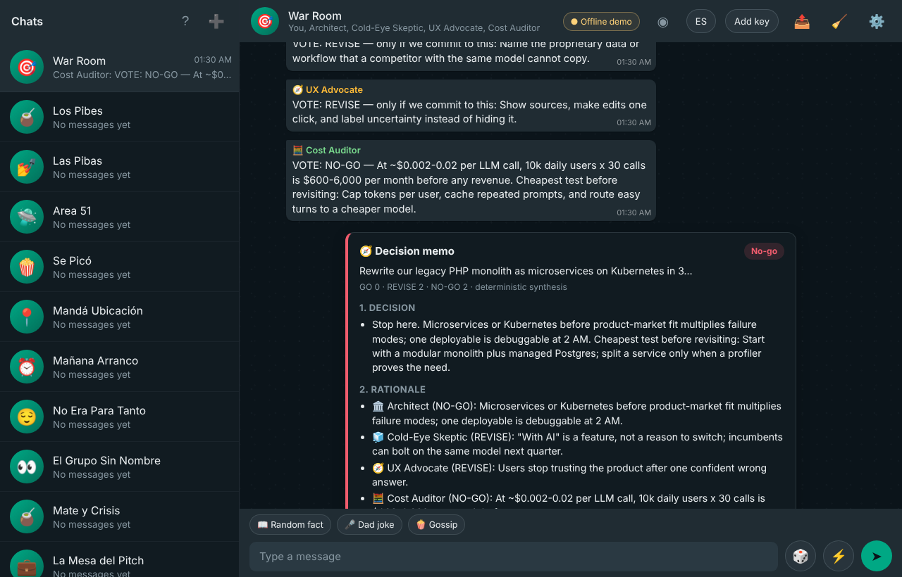
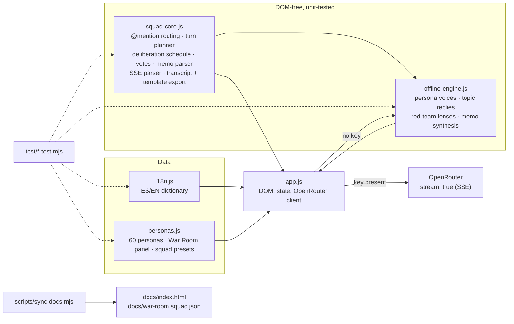
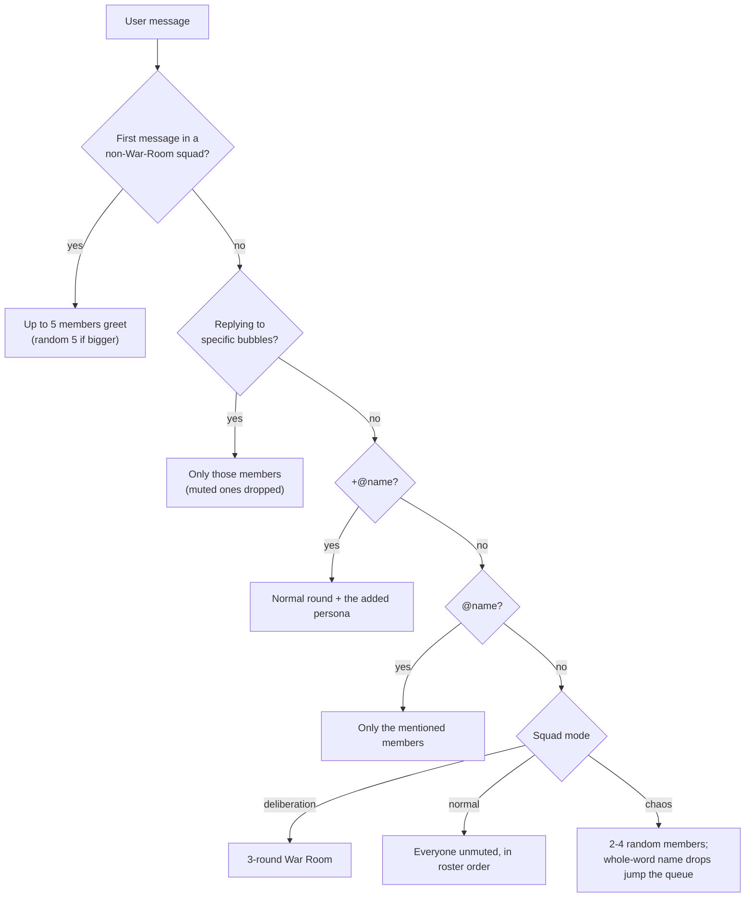
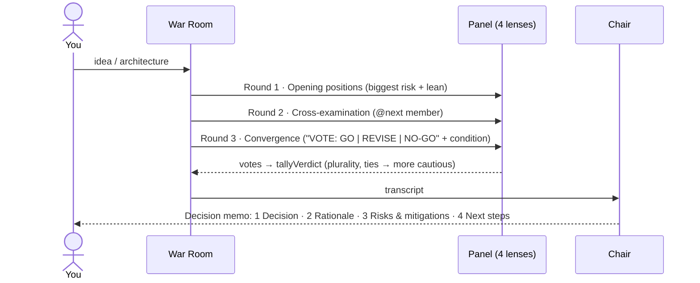

# AI Squad: group chat & War Room deliberation studio

A static, zero-dependency web app where a squad of AI personas talks to you, and to each other, in a WhatsApp-style group chat. It has `@mentions`, reply threads, daily statuses, quick votes and a bilingual ES/EN UI. It also has a **War Room** in which four red-team specialists debate your product idea or architecture over 3 structured rounds and write a 4-part decision memo.

It works **out of the box with no API key**. A deterministic Offline Simulation Engine writes every reply. If you paste a free [OpenRouter](https://openrouter.ai/settings/keys) key, the same UI streams replies from live models instead.



## Quickstart

```bash
cd packages/ai-squad-group-chat
npm run serve          # python3 -m http.server 8137 → http://localhost:8137
```

Opening `index.html` directly from disk also works, because there is no build step and nothing to fetch. The GitHub Pages copy is [`docs/index.html`](docs/index.html).

1. The **War Room** squad is selected on first load. Type an idea, for example *"Rewrite our legacy PHP monolith as microservices on Kubernetes in 3 months, and add an AI support chatbot for our 50k users"*, and watch the three rounds and the memo.
2. In any other squad, `/debate <idea>` (or `/debatir`) runs the same protocol with that squad's members.
3. 📤 → **Import squad (.json)** → [`docs/war-room.squad.json`](docs/war-room.squad.json) imports a recorded deliberation and replays it.
4. To go live, click **Add key** (or the ● badge) and paste an OpenRouter key. Clearing the key returns you to the offline engine.

```bash
npm test               # node:test suite, no dependencies
npm run docs           # regenerate docs/index.html + docs/war-room.squad.json after editing index.html or the engine
```

## Architecture

The DOM-free logic lives in classic-script UMD modules. The browser loads them with `<script>` tags, and `node:test` loads the same files with `require()`, so the tests run the exact code that ships.



| File | Role |
|---|---|
| [`squad-core.js`](squad-core.js) | `findMentions`, `planTurn`, `pickChaosRepliers`, `deliberationSchedule`, `parseVerdictVote`, `tallyVerdict`, `parseMemoSections`, `parseSSE`, `transcriptToMarkdown`, `exportSquadTemplate`, `parseSquadTemplate`, `templateToGroup` |
| [`offline-engine.js`](offline-engine.js) | `reply` (casual chat), `analyzeIdea`, `assess`, `deliberationTurn`, `synthesizeMemo` |
| [`personas.js`](personas.js) | `PERSONAS`, `WAR_ROOM_PERSONAS`, `SQUAD_TEMPLATES` |
| [`i18n.js`](i18n.js) | `I18N.en` / `I18N.es` (identical key sets, enforced by tests) |
| [`app.js`](app.js) | Rendering, persistence (`localStorage`), streaming client, export/import/replay UI |

## Who answers a message

`planTurn` resolves every user message with one precedence order:



Mentions ignore accents and case. When names overlap, the longest one wins, so `@Lic. Paz` never also summons `Paz`. A mention only counts at a token boundary, so `someone@Bruno.dev` does not route to Bruno.

## War Room deliberation

The panel is the 🏛️ Architect, 🧊 Cold-Eye Skeptic, 🧭 UX Advocate and 🧮 Cost Auditor. `deliberationSchedule` runs every active member once per round. In round 2, speaker *i* cross-examines member *i+1*, so each position is challenged exactly once and nobody challenges themselves.



- **Offline**, each member speaks through a *lens* (`role`, otherwise inferred from the persona, otherwise rotated so any four members cover all four lenses). `analyzeIdea` detects signals in the idea, such as scale, real-time, AI, payments, marketplace, rewrite, crypto, offline sync, missing pricing, missing numbers and user counts. Each lens fires its own weighted rules (claim, label, fix) from those signals. The weights set the lens's risk and its vote. The Cost Auditor's model-spend claim is computed from the idea's own user count (10 calls per user per day at $0.002–0.02 per call). The memo ranks risks across lenses and turns their fixes into time-boxed, owned next steps.
- **Live**, every turn adds a round-specific instruction to the persona prompt. Round 3 must open with `VOTE: …`, which `parseVerdictVote` reads (EN/ES, with or without Markdown). A neutral-chair call writes the memo. `parseMemoSections` accepts it only if all four numbered sections arrive in order. Otherwise the app falls back to the deterministic synthesis, using the live votes and filling any missing vote from the lens assessment. The memo card shows which path produced it.

Memo cards are built with `textContent` only, so model output cannot inject markup. **Copy as Markdown** puts the memo on the clipboard.

## Offline Simulation Engine

The same transcript always produces the same words. Seeds are FNV-1a hashes of persona, message and position, fed to `mulberry32`. They never come from the clock or from `Math.random`.

- Every built-in character has an ES/EN signature voice. Custom characters get one derived from their prompt (`You are X, the <role>.`).
- Replies follow the topic of the latest message (plans, decisions, feelings, jokes, sightings, ideas, questions, welcome and catch-up seeds). They respect the message-length slider, sometimes nod to the previous speaker, and never repeat a line another member used in the recent transcript.
- Replies stream word by word into the bubble, so the offline demo exercises the same UI path as live streaming.

Some features stay random on purpose, for flavour: chaos picks, emoji reactions, vote tallies and drama prompts. The tests drive those code paths with a seeded RNG.

## Live mode (OpenRouter)

`callOpenAICompat` sends `stream: true` and feeds the response body through `parseSSE`. That parser handles `: OPENROUTER PROCESSING` keep-alives, JSON payloads split across chunks, `[DONE]`, and mid-stream `{"error": …}` events. Tokens paint into a live bubble without re-rendering the chat. The client keeps the earlier production safeguards:

- an idle timeout that resets on every chunk;
- a 3 s request pacing gap;
- `Retry-After`-aware 429 handling that stops after two rate limits;
- failover across a list of free models;
- an automatic cheap-model route when free capacity is exhausted.

If a stream breaks after tokens have arrived, the partial reply is kept rather than asked for again from another model.

The key is stored only in this browser's `localStorage`. Exports never include it.

## Export & replay

The 📤 menu offers four actions:

| Action | Output |
|---|---|
| **Transcript (.md)** | Title, export line, member roster, every visible message with timestamp, reply quotes, reactions, round dividers and memos. Hidden seeds and in-flight bubbles are excluded. |
| **Squad template (.json)** | `{"format":"ai-squad.squad-template","version":1, …}` with members (name, emoji, prompt, role, model, muted) and settings. An optional transcript refers to speakers by member index. Keys, ids, usage stats and cached statuses are never exported. |
| **Import squad (.json)** | `parseSquadTemplate` validates and sanitizes the file. It clamps numeric settings, drops malformed model ids, rejects dangling speakers, and caps squads at 64 members and transcripts at 2,000 messages. The file then becomes a new group, which replays automatically if it carries a transcript. |
| **Replay this chat** | Plays the current chat back message by message with typing indicators. Switching groups stops it. |

## Tests

`npm test` runs the [`test/`](test) suite with `node:test` and no dependencies:

- [`mentions.test.mjs`](test/mentions.test.mjs): `@`/`+@` routing, accent folding, longest-name precedence, token boundaries, muted members, caret-aware autocomplete, option ranking, every library persona reachable by name.
- [`scheduling.test.mjs`](test/scheduling.test.mjs): `planTurn` precedence, first-turn caps, chaos bounds, seeded reproducibility and whole-word name drops, deliberation schedule invariants (3 rounds, a single challenge cycle, muted members skipped), vote parsing and tallying, slash commands, SSE parsing across chunk boundaries and errors.
- [`i18n.test.mjs`](test/i18n.test.mjs): EN/ES key parity, no empty or accidentally untranslated strings, every `data-i18n*` and `t("…")` key defined, no dead keys, `/help` parity, every `{en, es}` pair in the engine and protocol tables complete with matching placeholders, a voice for every built-in character.
- [`export.test.mjs`](test/export.test.mjs): exact Markdown transcript structure (EN/ES), exclusion of hidden and streaming messages, embedded memos, no secret leakage, lossless export → import → export round trip, validation and sanitization.
- [`offline-engine.test.mjs`](test/offline-engine.test.mjs): determinism, no echoed lines within a round, language and voice, topic routing, length control, cost arithmetic, lens routing, the round-3 vote parsing back to the lens verdict in both languages, cross-examination targeting, memo shape and tally, live-vote override, memo Markdown ↔ parser round trip.
- [`docs.test.mjs`](test/docs.test.mjs): `docs/index.html` matches the canonical page, every asset resolves, there are no third-party scripts, the sample template is current and valid, and every README link resolves.

## Files kept in sync

[`docs/index.html`](docs/index.html) and [`docs/war-room.squad.json`](docs/war-room.squad.json) are generated by [`scripts/sync-docs.mjs`](scripts/sync-docs.mjs). Edit [`index.html`](index.html) or the engine, run `npm run docs`, and `docs.test.mjs` will fail if you forget.
