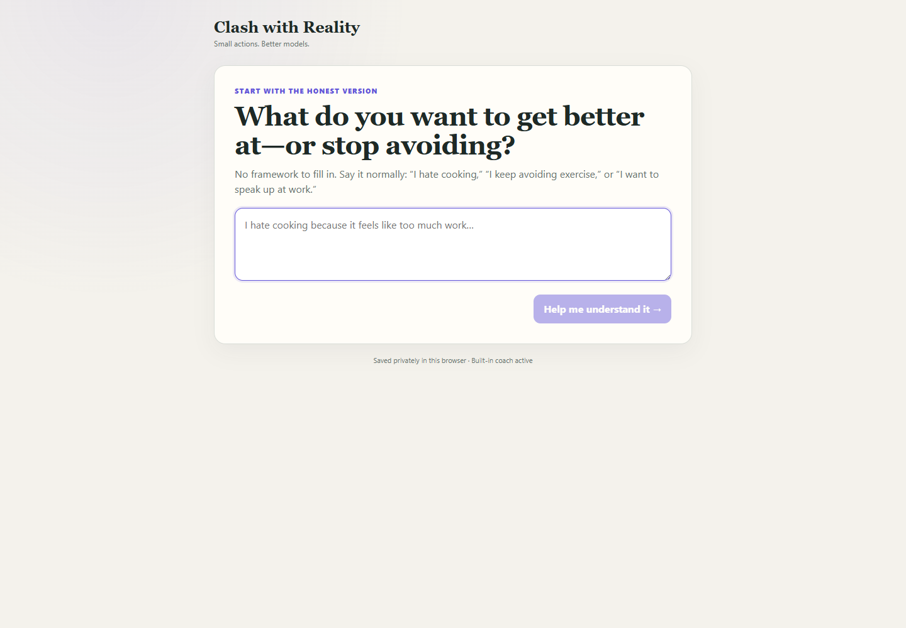
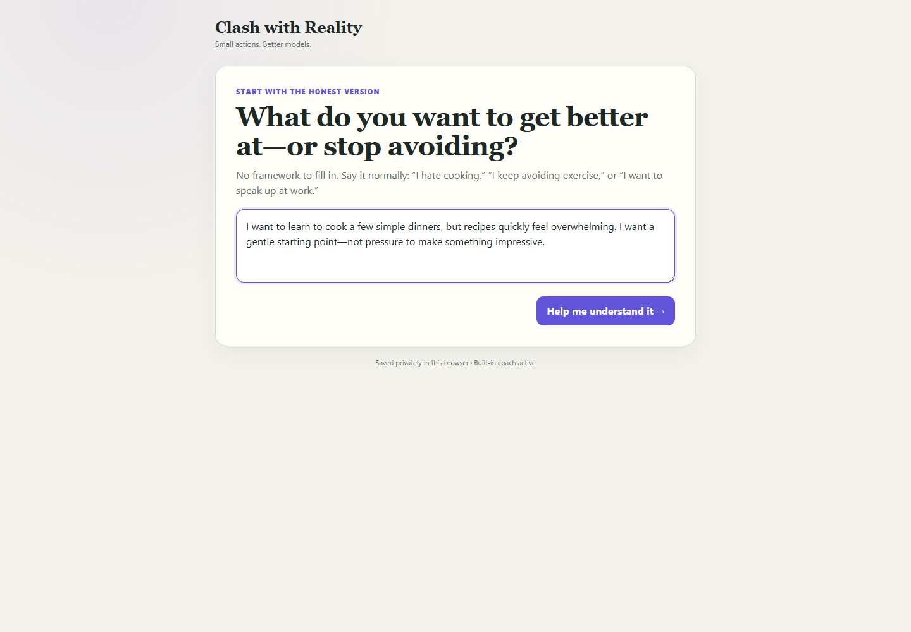
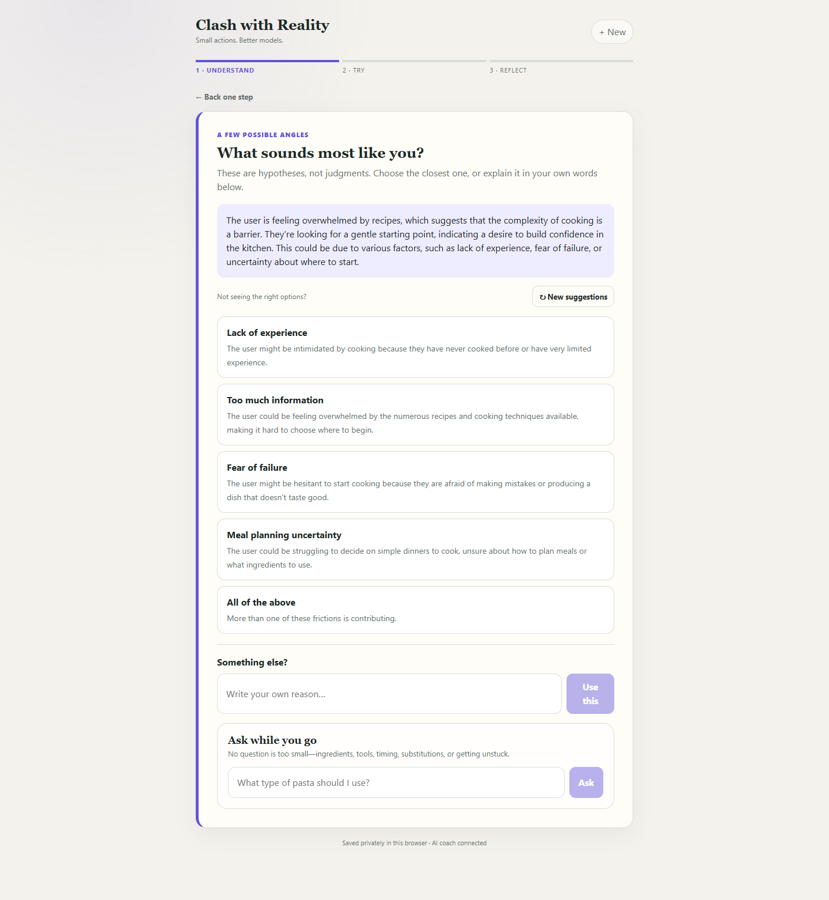
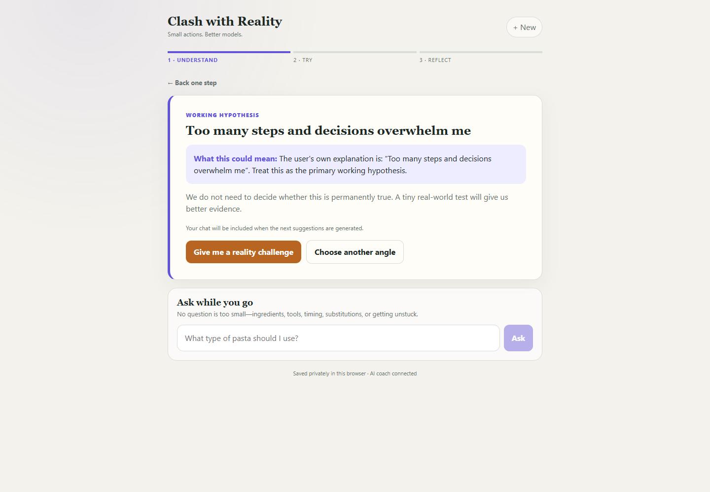
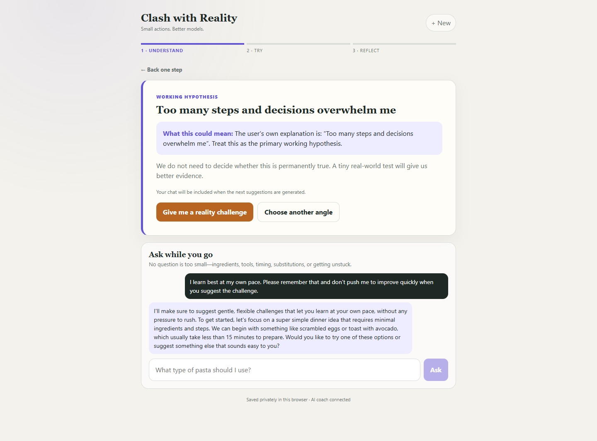
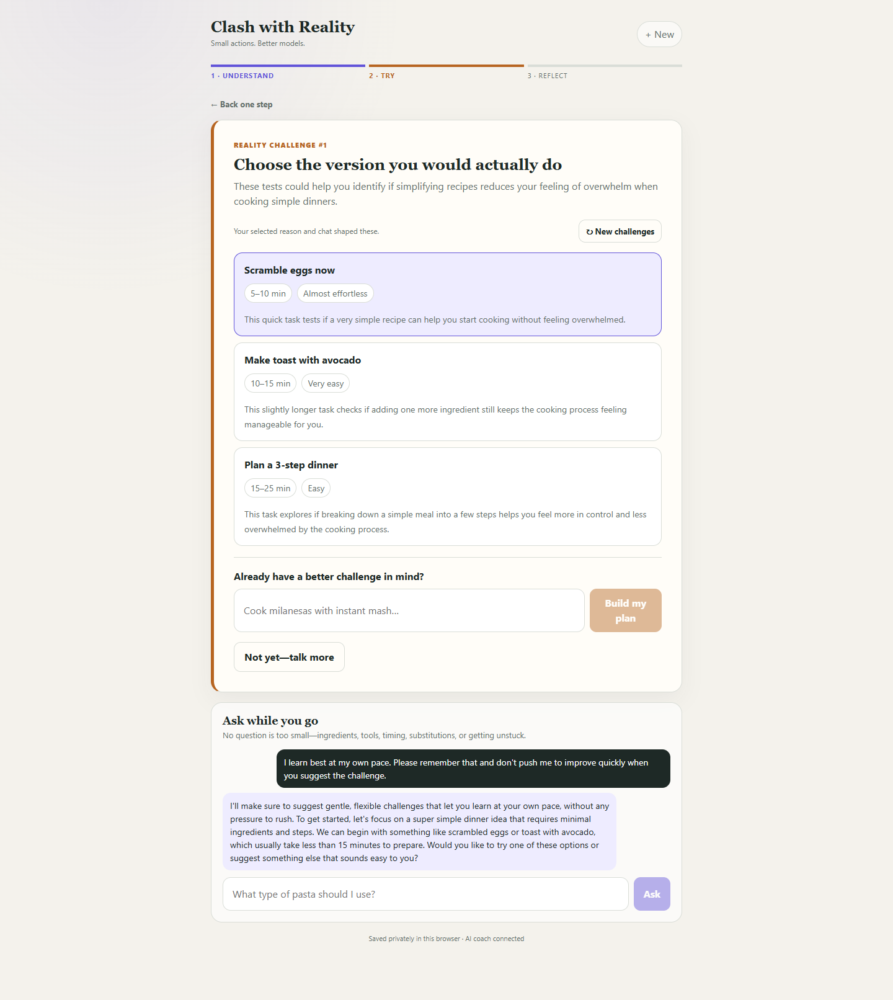
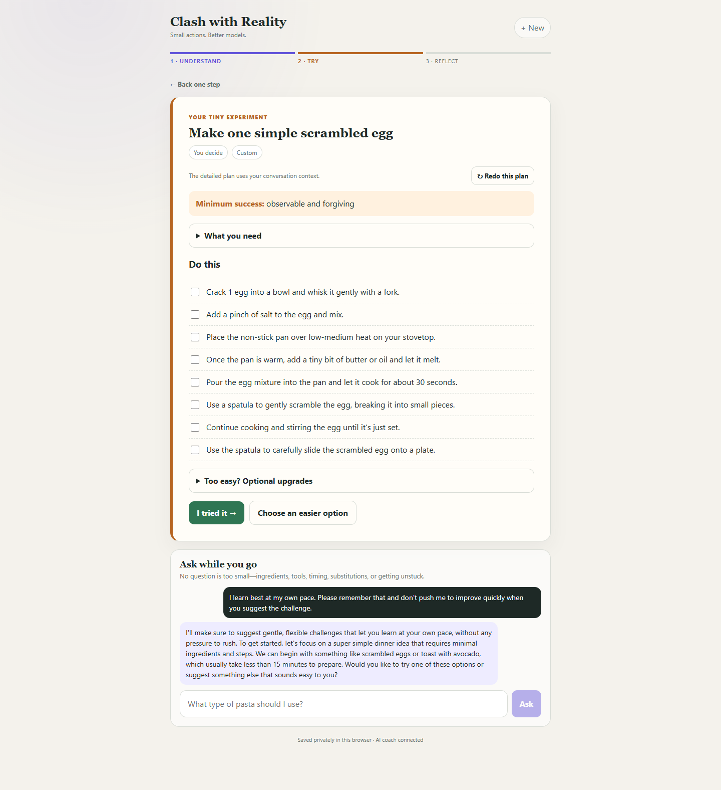
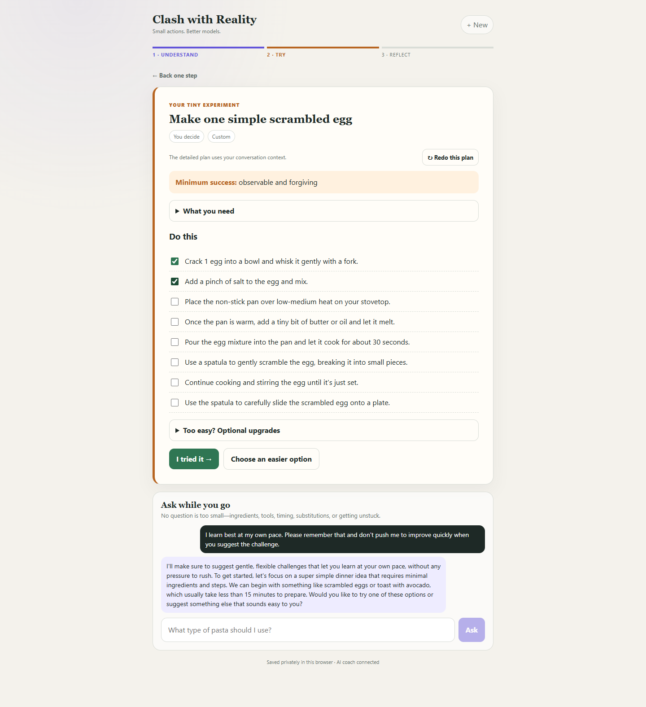
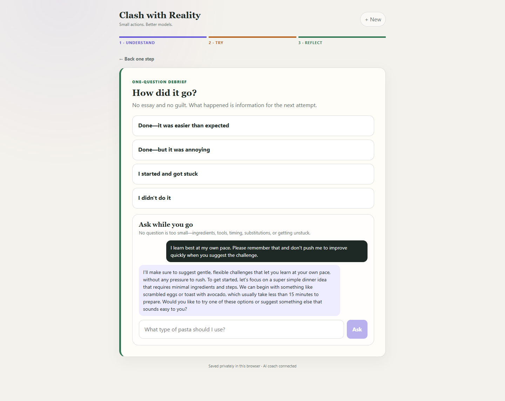
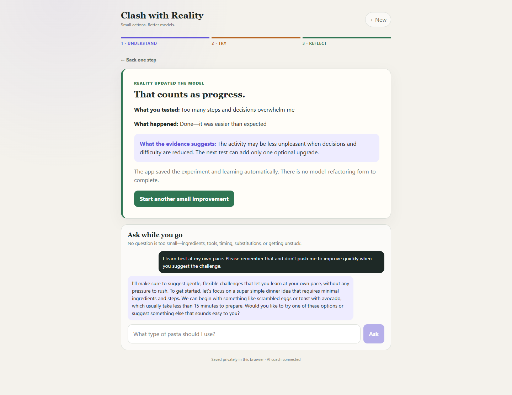

# Documented flow: learning to cook at your own pace

This walkthrough shows a normal end-to-end journey through **Clash with Reality**. The example user wants to learn a few simple dinners, but finds recipes overwhelming and does not want a coach pushing them to improve too quickly.

## Scenario

> I want to learn to cook a few simple dinners, but recipes quickly feel overwhelming. I want a gentle starting point—not pressure to make something impressive.

The flow demonstrates the product's central loop: describe the friction, treat the explanation as a hypothesis, run one tiny experiment, and use the outcome as evidence.

## 1. Welcome

The starting screen invites an honest, unstructured description.



## 2. State the goal honestly

The user explains both the desired improvement and the emotional constraint: cooking should feel gentle, not impressive.



## 3. Consider possible sources of friction

The coach separates the vague feeling of overwhelm into several testable possibilities without presenting any of them as a diagnosis.



## 4. Choose a working hypothesis

The user gives a more precise explanation in their own words: too many steps and decisions are the main source of friction.



## 5. Set the coaching boundary

The user explicitly asks to learn at their own pace and not be pushed to improve quickly. The coach acknowledges that preference and carries the conversation into the next suggestions.



## 6. Compare small reality challenges

The app proposes several low-pressure ways to test whether simplifying the cooking process reduces overwhelm. The user can also define their own challenge.



## 7. Turn the choice into a concrete plan

The user chooses **Make one simple scrambled egg**. The app translates that into small physical actions instead of asking for more planning or motivation.



## 8. Mark progress while acting

The checklist gives the user a visible sense of movement without requiring them to complete everything perfectly.



## 9. Debrief with one question

After the attempt, the app asks for a lightweight outcome rather than a long reflection form.



## 10. Capture the learning

The result updates the working model: reducing decisions and difficulty made the activity easier than expected. A future experiment can add only one optional upgrade.



## Recreate the screenshots

Run the app in one terminal:

```powershell
npm run dev
```

Then run the capture in another terminal:

```powershell
npm run capture:cooking-flow
```

The capture uses the local Google Chrome installation and overwrites the PNG files in this folder. Because the connected coach generates live responses, wording and challenge suggestions can vary between runs.
