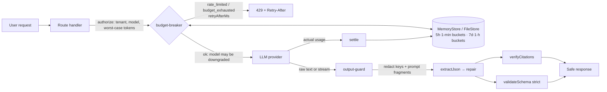
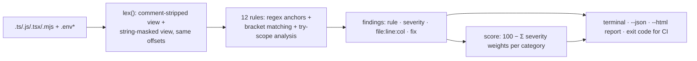

# llm-app-hardening-kit

Zero-dependency guards and a static scanner that catch the failure modes that take LLM apps down in their first week in production: runaway agent loops, leaked keys, forged webhooks, tool-call injection, malformed model JSON and double-charging retries.

- **`budget-breaker`**: deterministic cost circuit breaker with rolling 5-hour and 7-day caps, per-tenant rate limits, reserve→settle accounting, tiered fallback from flagship to cheaper models, and a lock-free multi-process file store.
- **`output-guard`**: extracts and repairs truncated or fenced JSON, validates strict schema contracts, strips leaked keys and verbatim system-prompt fragments (batch and streaming), and verifies citations against sources.
- **`repo-scanner`**: the `llm-harden` CLI. It runs 12 structure-aware rules over JS/TS and `.env*` files and produces a terminal, JSON or interactive HTML report.

Node.js ≥ 20, ESM, MIT. Types ship in [`src/index.d.ts`](src/index.d.ts).

**[▶ Sample report: Before vs. After Production Hardening](docs/demo-report.html)** (self-contained HTML; open it locally or through GitHub Pages)

## Architecture





## CLI

```bash
npx llm-harden scan ./my-app                  # exit 1 on any high/critical finding
```

```bash
npx llm-harden scan ./my-app --html audit.html --fail-on critical
```

```bash
npx llm-harden compare ./before ./after --html before-after.html
```

```bash
npx llm-harden rules
```

Exit codes: `0` clean, `1` findings at or above `--fail-on` (default `high`; `none` never fails), `2` usage error. A reviewed line can be suppressed with `// llm-harden-ignore HK005` on that line or the line above (omit the ID to suppress every rule there). The scanner skips `node_modules`, `.git`, `.next`, `dist`, `build`, `out`, `coverage` and `vendor`, and files over 1 MiB.

### Rules

| Rule | Category | Severity | Detects |
|---|---|---|---|
| `HK001` | Prompt/Key Leak Surface | critical | `NEXT_PUBLIC_` / `VITE_` / `REACT_APP_` / `EXPO_PUBLIC_` / `PUBLIC_` LLM keys, in code or `.env*` |
| `HK002` | Prompt/Key Leak Surface | critical | Hard-coded `sk-…`, `sk-ant-…`, `AIza…`, `gsk_…`, `xai-…`, `hf_…`, `r8_…` literals (placeholders ignored) |
| `HK003` | Prompt/Key Leak Surface | high | `dangerouslyAllowBrowser: true`, or a provider SDK imported into a `'use client'` module |
| `HK004` | Cost Ceiling Protection | critical | `while (true)`, `for (;;)`, `while (!done)` or `do…while (true)` loops that call a model without a turn, step or budget bound |
| `HK005` | Cost Ceiling Protection | medium | OpenAI / Anthropic / AI SDK / Gemini calls without `max_tokens`-family caps |
| `HK006` | Cost Ceiling Protection | medium | Raw `fetch` to a provider API without `signal` / `timeout` |
| `HK007` | Idempotency & Webhook Integrity | critical | Webhook `POST` handlers with no signature verification (`constructEvent`, HMAC + `timingSafeEqual`, svix, …) |
| `HK008` | Tool-Call Injection | critical | `exec` / `execSync` with interpolated or concatenated commands; `spawn` / `execFile` with `shell: true` |
| `HK009` | Tool-Call Injection | critical | SQL built by interpolation or concatenation in `.query` / `.execute` / `$queryRawUnsafe` / … |
| `HK010` | Tool-Call Injection | critical | `eval` of non-literal input, `new Function`, `vm.run*` |
| `HK011` | Schema Reliability | high | `JSON.parse` of model output or tool arguments outside any `try` |
| `HK012` | Idempotency & Webhook Integrity | high | Stripe `*.create` calls, or `POST` to `api.stripe.com`, with no idempotency key |

These are static heuristics, not a proof. The rules favour precision, so a call made through an indirection the scanner cannot see (for example `create(params)` with a variable argument) is not reported.

## Benchmark scorecard

[`evals/fixtures/`](evals/fixtures) holds 25 realistic broken snippets. Each one has a hardened twin that fixes the same code, plus decoys such as stream-reader `while (!done)` loops, `execFile` with argument arrays, tagged `sql` templates, `@ai-sdk/react` in client components and keys mentioned in comments. [`evals/manifest.json`](evals/manifest.json) lists the exact rule set each broken tree must produce. `npm run bench` prints the table below, and `node --test` fails if any number changes.

| Rule | Detects | Expected | Detected | Missed | False positives |
|---|---|---:|---:|---:|---:|
| `HK001` | LLM provider key exposed to the browser bundle | 3 | 3 | 0 | 0 |
| `HK002` | Hard-coded LLM provider secret | 2 | 2 | 0 | 0 |
| `HK003` | Provider SDK shipped to the browser | 2 | 2 | 0 | 0 |
| `HK004` | Unbounded agent loop (no max turns or cost ceiling) | 3 | 3 | 0 | 0 |
| `HK005` | Model call without an output token cap | 3 | 3 | 0 | 0 |
| `HK006` | Raw provider fetch without timeout | 2 | 2 | 0 | 0 |
| `HK007` | Webhook handler without signature verification | 2 | 2 | 0 | 0 |
| `HK008` | Shell command built from tool-call input | 2 | 2 | 0 | 0 |
| `HK009` | SQL built from tool-call input | 2 | 2 | 0 | 0 |
| `HK010` | Model output executed as code | 2 | 2 | 0 | 0 |
| `HK011` | Unguarded JSON.parse of model output | 2 | 2 | 0 | 0 |
| `HK012` | Side-effecting payment call without idempotency key | 1 | 1 | 0 | 0 |
| **Total** | 25 broken + 25 hardened trees | **26** | **26** | **0** | **0** |

Recall 100.0% · precision 100.0% · hardened trees clean 25/25. The kit's own `src/` also scans clean. This is a regression suite written alongside the rules; it does not measure accuracy on unseen codebases.

Before vs. after on the [sample app](evals/sample-app) (a Next.js support agent with tools, Stripe refunds and a billing webhook), as rendered in [`docs/demo-report.html`](docs/demo-report.html):

| Category | Before | After |
|---|---:|---:|
| Cost Ceiling Protection | 35 | 100 |
| Prompt/Key Leak Surface | 0 | 100 |
| Tool-Call Injection | 50 | 100 |
| Schema Reliability | 70 | 100 |
| Idempotency & Webhook Integrity | 20 | 100 |
| **Overall** | **35** | **100** |

Category score = 100 − Σ severity weights of its findings (critical 50, high 30, medium 15, low 5), floored at 0; overall = mean of categories. Run `npm run report` to regenerate the report; a test fails if the committed copy is stale.

Measured once on Node 22 in a cloud container, so the numbers depend on the machine: the scanner runs about 24k lines/s, `extractJson` repairs a truncated 58 KB payload in about 10 ms, and the breaker does about 5k authorize+settle pairs/s on `MemoryStore`.

## Budget breaker

```js
import { createBudgetBreaker, FileStore, BudgetExceededError } from 'llm-app-hardening-kit';

const breaker = createBudgetBreaker({
  // USD per 1M tokens. Illustrative values only: copy current prices from your provider.
  pricing: {
    'flagship-model': { inputPerMTok: 5, outputPerMTok: 25 },
    'mid-model':      { inputPerMTok: 1, outputPerMTok: 5 },
    'cheap-model':    { inputPerMTok: 0.1, outputPerMTok: 0.4 },
  },
  // Each tier may raise utilization of every cap only up to `until`.
  routes: [{ model: 'flagship-model', until: 0.6 }, { model: 'mid-model', until: 0.9 }, 'cheap-model'],
  caps: {
    global: { '5h': { usd: 50 }, '7d': { usd: 500, tokens: 200_000_000 } },
    tenant: { '5h': { usd: 2 },  '7d': { usd: 20 } },
  },
  rateLimit: { capacity: 30, refillPerSec: 0.5 },   // per tenant
  store: new FileStore('/var/lib/my-app/llm-budget'),
});

try {
  const { value, model, downgraded } = await breaker.run(
    { tenant: org.id, model: 'flagship-model', inputTokens: 6_000, maxOutputTokens: 1_500, key: `turn:${turnId}` },
    async ({ model }) => {
      const res = await client.messages.create({ model, max_tokens: 1_500, messages });
      return { value: res, usage: { inputTokens: res.usage.input_tokens, outputTokens: res.usage.output_tokens } };
    },
  );
} catch (err) {
  if (err instanceof BudgetExceededError) return new Response(err.reason, { status: 429, headers: { 'retry-after': String(Math.ceil((err.retryAfterMs ?? 3_600_000) / 1000)) } });
  throw err;
}
```

- **Reserve, then settle.** `authorize` reserves the worst-case cost (`inputTokens + maxOutputTokens`) before the call, so concurrent requests cannot overshoot a cap. `settle` swaps in actual usage, and `release` refunds a call that never reached the provider. `run` does all three. A reservation that is never settled stays charged, so the breaker fails closed.
- **Windows.** The 5h window uses 300 one-minute buckets and the 7d window uses 168 one-hour buckets, so a window rolls forward at bucket granularity. `retryAfterMs` is the exact time until enough old buckets expire to admit the request. `request_exceeds_cap` means the request could never fit.
- **Determinism.** Money is integer micro-USD (tokens × USD/1M tokens), and time comes from the injectable `now()`, so the same inputs always give the same decisions.
- **Idempotency.** Passing the same `key` twice returns the existing reservation instead of charging again.
- **`FileStore`** is lock-free and multi-process safe on one host. Each commit publishes an immutable `state.<n>.json` with `link(2)`, which fails atomically if another writer took `n` (compare-and-swap); the loser re-reads and retries. Snapshots are collected by age (`gcAgeMs`, 30 s), and an attempt whose read→commit window exceeds `commitWindowMs` (2 s) is retried, so a slow writer can never re-create a collected version (ABA). The test suite runs 4 threads × 50 contended updates and requires exactly 200 committed versions. Every commit rewrites the whole state, so for high-QPS or multi-host fleets, implement the one-method `Store` interface (`transact(fn)`) on Redis or Postgres. It also needs a filesystem with hard links, which rules out FAT and some network mounts.

## Output guard

```js
import { guardOutput, extractJson, validateSchema, createStreamGuard, verifyCitations } from 'llm-app-hardening-kit';

const r = guardOutput(completionText, {
  systemPrompt: SYSTEM,                  // any run of ≥ 8 consecutive words copied from it is redacted
  secrets: [process.env.INTERNAL_TOKEN], // exact values, e.g. canaries
  schema: { type: 'object', required: ['total', 'currency'],
            properties: { total: { type: 'number', minimum: 0 }, currency: { type: 'string', pattern: '^[A-Z]{3}$' } } },
});
if (!r.ok) return Response.json({ error: 'bad_model_output', details: r.schema?.errors ?? r.json?.error }, { status: 422 });
r.json.value;   // parsed, repaired if needed (r.json.repaired / r.json.truncated tell you)
```

- **`extractJson`** tries ` ```json ` fences first, then other fences, then raw text. Repair closes unterminated strings and containers, drops dangling keys and partial literals (`tru`, `1.`), removes trailing commas, escapes raw newlines inside strings and ignores trailing prose. `truncated: true` tells you content was cut, so you can retry or ask for a continuation instead of trusting a partial object.
- **`validateSchema`** covers this JSON Schema subset: `type`, `enum`, `const`, `properties`, `required`, `additionalProperties`, `items`, `prefixItems`, `min/maxItems`, `uniqueItems`, `min/maxLength`, `pattern`, `minimum`/`maximum`/`exclusive*`, `multipleOf`, `allOf`/`anyOf`/`oneOf`/`not`. In strict mode (the default) objects that declare `properties` reject unknown keys. Errors are JSON Pointers.
- **`redact`** removes OpenAI, Anthropic, Stripe, Google, AWS, GitHub, Slack, Groq, xAI and Hugging Face keys, JWTs, bearer tokens and PEM private keys, plus your exact secrets and verbatim system-prompt fragments (case- and punctuation-insensitive word shingles). Paraphrases are not caught.
- **`createStreamGuard({ holdback })`** returns `push(chunk)` / `end()` and holds back `holdback` characters (512 by default), so a key split across chunks is still caught. Output is identical to batch `redact` for any chunking when each secret and prompt fragment fits in the holdback. Text already sent cannot be recalled: at most `minWords − 1` words of a prompt fragment can go out before the fragment becomes detectable.
- **`verifyCitations`** checks that each `[1]`, `[^2]`, `[1, 3]` or `[S4]` marker resolves to a supplied source, and that a quote directly before a marker (`"…" [2]`) appears in that source's text. Unknown ids, fabricated quotes, or no citations at all make the result invalid.

## Development

```bash
npm test             # node --test: fixtures, guards, breaker, CLI, report freshness
```

```bash
npm run bench        # scorecard table
```

```bash
npm run report       # regenerate docs/demo-report.html
```

Fake keys in fixtures are random strings shaped like provider keys. They are not credentials.
