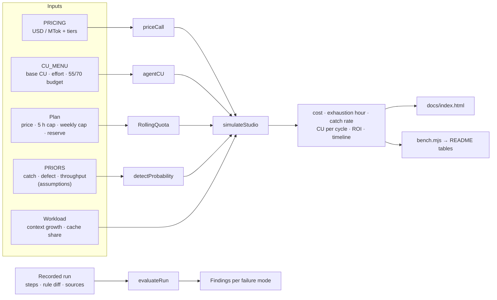
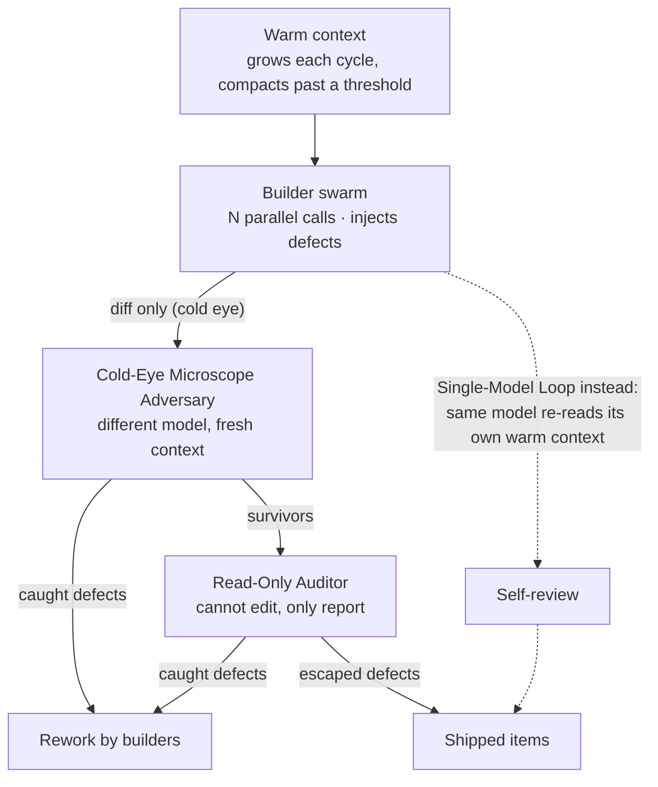

# multi-model-routing-bench

A zero-dependency calculator, workflow simulator and failure-mode harness for multi-agent software and research studios. It answers one question with numbers you can reproduce: **for a given subscription, API rate card and workload, what does a single-model loop cost and catch compared with tri-cameral role routing?**

- [`src/cu-engine.mjs`](src/cu-engine.mjs) prices requests (input, cached input, cache writes, output, long-context tier jumps), meters Cost Units (CU) against a rolling burst window and a weekly ceiling with a reserve, and simulates multi-cycle autonomous workflows down to ROI.
- [`src/role-eval.mjs`](src/role-eval.mjs) checks recorded agent runs for premature self-editing, sycophantic self-approval, unbounded rule bloat, fake citations and role-boundary breaches.
- [`docs/index.html`](docs/index.html) is the interactive CU Routing Calculator. It runs the same engine in the browser.

Requires Node.js 20 or newer. There are no npm dependencies.

```bash
npm test         # unit and simulation tests
npm run bench    # prints the tables below
npm start        # calculator at http://127.0.0.1:4490/
```

Browsers block ES module imports on `file://`, so open the calculator through `npm start` or any static server rooted at this package.

## Architecture



## One cycle

A cycle is one build wave and its review chain. Defects that a reviewer catches go back to the builders as rework; defects nobody catches escape.



## The model

| Quantity | Definition |
|---|---|
| Request USD | `(input·r_in + cached·r_cached + write·r_write + output·r_out) / 1e6`, where `r` is the highest tier whose threshold the prompt (`input + cached + write`) exceeds. The tier applies to the whole request. Output does not count toward the threshold. |
| Agent CU | `Base CU × Effort Multiplier`, plus `+5 CU` for a raw-cache read (the bloat penalty), as in the Claude engine's [`ARCHITECT_BLUEPRINT.md`](../../0-SelfEvolveUniversalTemplate/SelfEvolvingArchitectureClaude/ARCHITECT_BLUEPRINT.md) §4. Each cycle is checked against the `≤ 55 CU` target and the `70 CU` ceiling. |
| Burst window | Usage counts events in `(t − 5 h, t]`. A phase is admitted only if it fits the window cap and the weekly allowance, which is `weeklyCap × (1 − reserve)`. |
| Overflow | `api` bills calls the plan refuses at API rates and keeps pace. `wait` sleeps until the earliest expiry that frees enough room. If a single phase exceeds a cap, `wait` stops with `stoppedReason: 'quota'`. |
| Catch probability | `(1 − (1 − q)^effort) · (1 − ρ)`. `q` is the per-look catch rate, effort buys independent looks, and `ρ` is the blind spot the reviewer shares with the author: warm self-review `0.6`, same model cold `0.3`, cross-model `0.05`. |
| Defects injected | `items × defectRate / √effort` per builder wave. |
| Results | `items − defectPenalty × escaped` (default penalty `1`). |
| Effective cost | `API billed + plan price × elapsed hours / period hours` (month = 730 h, week = 168 h). |
| ROI | `Results / (Effort × Time × Cost)`: mean effort multiplier × elapsed hours × effective USD. |

Every result is an expected value. The simulation uses no randomness, so the same input always gives the same output.

### What is sourced and what is assumed

| Input | Status |
|---|---|
| `PRICING` | Anthropic first-party rates, 2026-10 snapshot. Opus 5.5 $4 / $20, cache read $0.20. Sonnet 5.5 $2 / $10, cache read $0.20. Haiku 5.5 $0.10 / $0.50 up to a 100k-token prompt and $0.50 / $2.50 above it, cache reads 0.1×. Cache writes are 1.25× input (5-minute TTL). Check current rates before budgeting. None of these models has a 200k tier; the engine supports any number of tiers, and the tests cover a >100k / >200k card. |
| `CU_MENU` | Copied from the Claude engine blueprint §4. |
| `PRIORS` | **Assumptions.** Catch rate per look, defects per item, tokens per second and the correlation constants are illustrative priors, not measurements. Replace them with your own eval data, either in the calculator's *Priors* panel or with `simulateStudio({ priors })`. |
| Plan caps | **Illustrative.** Subscription quotas are not published in CU. Set the window and weekly caps from your own observed usage. |

## Benchmark

These are the default workload, priors and an illustrative $200/month plan (400 CU per 5 h, 4,000 CU per week, 20% reserve). "Single-Model Loop" is four builders plus warm self-review on the same model. "Tri-Cameral" is four Haiku `medium` builders, a cold Sonnet `high` adversary and a cold Opus `light` read-only auditor.

<!-- bench:start -->
### Request pricing and tier jumps

| Model | 50k prompt, 70% cached, 6k out | 150k prompt, 70% cached, 6k out |
|---|---:|---:|
| `claude-opus-5-5` | $0.1870 | $0.3210 |
| `claude-sonnet-5-5` | $0.0970 | $0.1710 |
| `claude-haiku-5-5` | $0.0049 | $0.0428 (> 100k tier) |

### Agent CU (Base CU x Effort Multiplier)

| Model | `light` | `medium` | `high` | `extra high` | `max` |
|---|---:|---:|---:|---:|---:|
| `claude-opus-5-5` | 4.80 | 8.00 | 12.80 | 20.00 | 32.00 |
| `claude-sonnet-5-5` | 1.08 | 1.80 | 2.88 | 4.50 | 7.20 |
| `claude-haiku-5-5` | 0.48 | 0.80 | 1.28 | 2.00 | 3.20 |

### 24 h studio: Pure API

| Roster | Cycles | CU / cycle | Effective USD | API-equiv USD | Exhausted at | Catch rate | Escaped | Clean results | USD / result | ROI |
|---|---:|---:|---:|---:|---:|---:|---:|---:|---:|---:|
| Single-Model Loop (opus-5-5, high) | 417 | 65.2 (over-target) | $506.92 | $506.92 | never | 28.9% | 93.8 | 1574.2 | $0.32 | 0.0808 |
| Single-Model Loop (sonnet-5-5, medium) | 591 | 9.2 (within-target) | $378.82 | $378.82 | never | 18.0% | 310.2 | 2053.8 | $0.18 | 0.226 |
| Tri-Cameral Role Routing | 586 | 11.5 (within-target) | $207.72 | $207.72 | never | 73.5% | 155.2 | 2188.8 | $0.09 | 0.426 |

### 24 h studio: Plan, overflow billed at API rates

| Roster | Cycles | CU / cycle | Effective USD | API-equiv USD | Exhausted at | Catch rate | Escaped | Clean results | USD / result | ROI |
|---|---:|---:|---:|---:|---:|---:|---:|---:|---:|---:|
| Single-Model Loop (opus-5-5, high) | 417 | 65.2 (over-target) | $477.22 | $506.92 | 0.35 h | 28.9% | 93.8 | 1574.2 | $0.30 | 0.0858 |
| Single-Model Loop (sonnet-5-5, medium) | 591 | 9.2 (within-target) | $245.47 | $378.82 | 1.75 h | 18.0% | 310.2 | 2053.8 | $0.12 | 0.349 |
| Tri-Cameral Role Routing | 586 | 11.5 (within-target) | $154.48 | $207.72 | 1.42 h | 73.5% | 155.2 | 2188.8 | $0.07 | 0.573 |

### 24 h studio: Plan, wait for the window

| Roster | Cycles | CU / cycle | Effective USD | API-equiv USD | Exhausted at | Catch rate | Escaped | Clean results | USD / result | ROI |
|---|---:|---:|---:|---:|---:|---:|---:|---:|---:|---:|
| Single-Model Loop (opus-5-5, high) | 31 | 65.2 (over-target) | $6.87 | $35.49 | 0.35 h | 28.9% | 7.0 | 117.0 | $0.06 | 0.425 |
| Single-Model Loop (sonnet-5-5, medium) | 216 | 9.2 (within-target) | $6.86 | $139.00 | 1.75 h | 18.0% | 113.4 | 750.6 | $0.01 | 4.37 |
| Tri-Cameral Role Routing | 174 | 11.5 (within-target) | $6.86 | $61.49 | 1.42 h | 73.5% | 46.1 | 649.9 | $0.01 | 3.67 |

### Sensitivity: what an escaped defect costs (plan, wait for the window)

| Roster | ROI, 1 lost / escape | ROI, 2 lost / escape | ROI, 4 lost / escape | ROI, 8 lost / escape |
|---|---:|---:|---:|---:|
| Single-Model Loop (opus-5-5, high) | 0.425 | 0.400 | 0.349 | 0.248 |
| Single-Model Loop (sonnet-5-5, medium) | 4.37 | 3.71 | 2.39 | -0.249 |
| Tri-Cameral Role Routing | 3.67 | 3.41 | 2.89 | 1.85 |
<!-- bench:end -->

### Reading the tables

- **Pure API, or a plan whose overflow is billed:** tri-cameral routing has the lowest cost per clean result and the highest ROI. It catches 73.5% of defects, against 28.9% for Opus self-review and 18.0% for Sonnet self-review. Cheap builders inject more defects, but two cold reviewers on different models remove most of them. Cold reviewers also read a 12k-token spec and diff instead of the builders' growing context.
- **The Opus `high` single-model loop costs 65.2 CU per cycle**, which breaches the 55 CU target. Under the plan it exhausts the burst window after 21 minutes. Under `wait` it spends 23 of 24 hours idle.
- **Under a capped plan with `wait`, the winner depends on what an escaped defect costs.** If an escape costs one item, a Sonnet single-model loop ships the most clean results, because it completes more cycles per CU. Once an escape costs between two and four items, tri-cameral routing wins, and at eight items the Sonnet loop's ROI goes negative. Set `defectPenalty` to what an escape costs your studio.
- **Tier jumps:** the Haiku builders' warm context crosses 100k tokens before compaction at 160k, so 960 of their calls are billed at the long-context rate. Compacting earlier (`compactAt ≤ 100_000`) removes those jumps.

## Failure-mode and role-fit harness

`evaluateRun(run, limits?)` takes a recorded run and returns `{ pass, score, modes, findings }`. `pass` is false if there is any error. `score` is the share of the five modes with no errors. Each finding names its mode, check, severity, step index and agent.

| Mode | Check | Severity | Fires when |
|---|---|---|---|
| `PREMATURE_SELF_EDIT` | `self-graded` | error | An agent reviews or grades a target it authored (scouting and grading collapsed) |
| | `scout-graded` | error | A scout's output carries a grade (`Status: Try-worthy`, `G2: pass`, `grade: B`) |
| | `edit-before-review` | warn | The author edits its own work again before any other agent has reviewed it |
| `SYCOPHANTIC_SELF_APPROVAL` | `author-approval` | error | The author approves its own work |
| | `warm-same-model` | warn | The approver runs the author's model on warm context |
| | `no-evidence` | error / warn | An approval cites no evidence (`file:line`, `line N`, code span, quoted text, `[verified: …]`). It is an error when the approval is praise ("LGTM", "excellent") and a warning otherwise. |
| `UNBOUNDED_RULE_BLOAT` | `too-many-rules` | error | More than `maxAddedRules` (3) new rule lines in one iteration |
| | `growth` | error | The file grows by more than `maxGrowth` (1.2×) and by at least `minGrowthBytes` (200) |
| | `duplicate` | warn | Two rules have a word-set Jaccard similarity ≥ `duplicateJaccard` (0.8) |
| `FAKE_CITATION` | `malformed-url` / `empty-quote` | error | `[verified: <url> "<quote>"]` has a URL that is not http(s), or has no quote |
| | `quote-not-in-source` | error | The quote is missing from the cached source (whitespace, case and curly quotes are normalized) |
| | `unverifiable` | warn | No cached source exists for the URL |
| `ROLE_BOUNDARY` | `out-of-role` / `unknown-role` | error | A read-only auditor or adversary writes or edits, or the role is unknown |

```js
import { evaluateRun } from './src/role-eval.mjs';

evaluateRun({
  steps: [
    { agent: 'b1', role: 'builder', kind: 'write', target: 'leads/a.md', model: 'claude-haiku-5-5' },
    { agent: 'b1', role: 'auditor', kind: 'grade', target: 'leads/a.md', verdict: 'approve', text: 'LGTM!' },
  ],
  rules: { before: oldAgentsMd, after: newAgentsMd },
  sources: { 'https://example.org/call': cachedText },
});
// → pass: false; self-graded, author-approval and no-evidence (praise) errors
```

Roles and what they may do are in `ROLE_CAPS`: `scout` (scout, write), `builder` (write, edit), `adversary` (review), `auditor` (review, grade) and `grader` (grade).

## Calculator

[`docs/index.html`](docs/index.html) puts every engine input in a form: the plan, the overflow policy, both rosters, the API rate card including tier thresholds, the workload, and the priors. Any change re-runs both simulations. The results table highlights the better roster on each metric. The chart shows cumulative effective cost, CU or escaped defects over the simulated day, with a crosshair tooltip and a dashed marker at each roster's quota-exhaustion hour.

## Tests

`npm test` runs [`test/cu-engine.test.mjs`](test/cu-engine.test.mjs) (pricing, tiers, CU, quota windows, a hand-computed cycle, routing comparisons), [`test/role-eval.test.mjs`](test/role-eval.test.mjs) (every check, with positive and negative cases) and [`test/docs.test.mjs`](test/docs.test.mjs). The last one fails if the tables above drift from `npm run bench`, or if the calculator imports a name the engine does not export.

## Limits

- The simulation tracks expected values. It does not model variance, retries, rate-limit errors or server-side latency.
- Every builder in a swarm runs the same model and effort, and rework always succeeds.
- Quota is metered per phase at the phase's start time, and each review chain runs in order.
